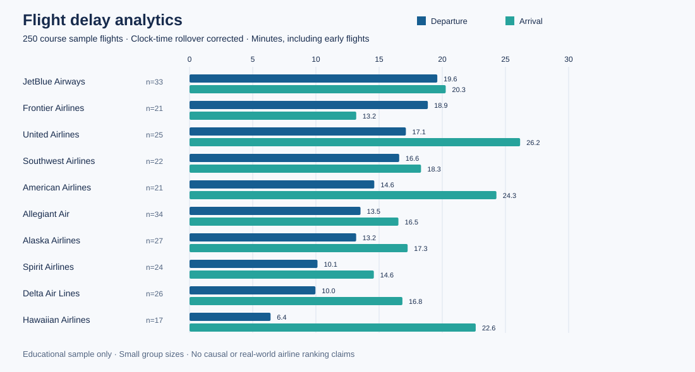
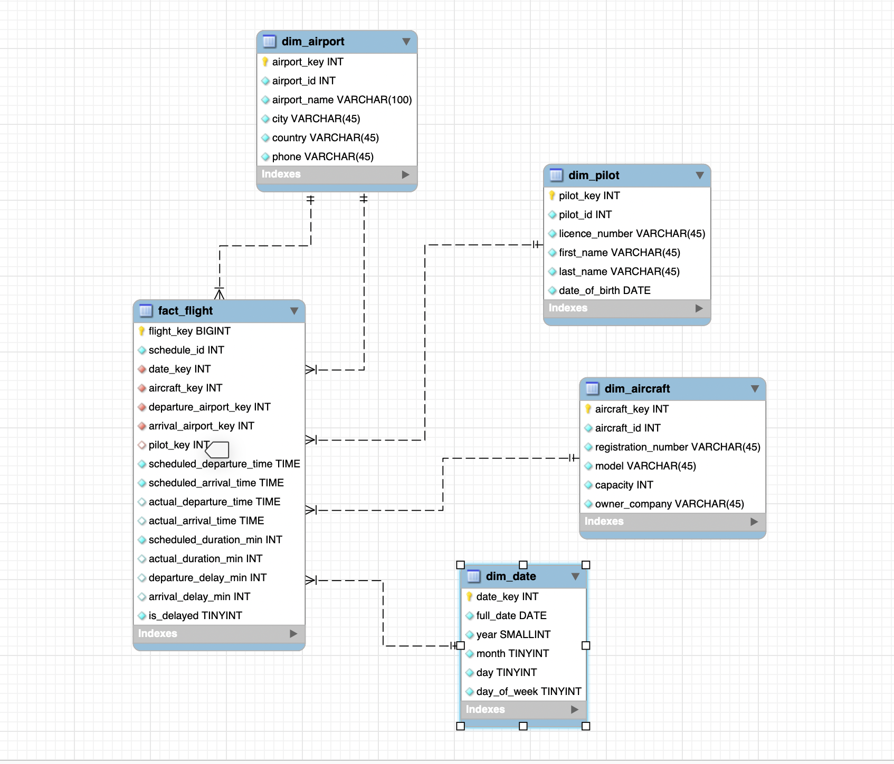

# Flight Delay Data Warehouse

### ETL and BI Reporting

**Business Intelligence for Data Science · Tilburg University · Master's group project · 2025 · Grade: 10/10**

A business intelligence workflow for exploring airline punctuality: model operational flight data, transform it into a star-schema warehouse, and compare delays by airport, airline, and date. The course work used **MySQL Workbench, Pentaho Data Integration, SQL views, and Pentaho Report Designer**.

This portfolio preserves the available project evidence and adds a **Python + SQLite reproduction** so reviewers can inspect and run the analysis without installing the original desktop tools. The reproduction was added during portfolio preparation in October 2026; it is separate from the original group submission.

[Project case study](docs/case-study.md) · [Original Pentaho sources](pentaho/README.md) · [Native setup guide](docs/original-pentaho.md) · [Data and assumptions](docs/data-and-methods.md) · [Original report](reports/original/airport-delay-report.pdf)



## What the project demonstrates

- Relational modelling of schedules, aircraft, airports, pilots, and flight executions.
- Dimensional modelling at **one row per actual flight execution**, with surrogate keys and a role-playing airport dimension for departure and arrival.
- ETL concepts: lookups, key mapping, date attributes, calculated measures, and fact loading, documented in the original Pentaho evidence.
- SQL aggregation and business reporting at airport, airline, and daily levels.
- Reproducibility and data quality: a portable rebuild, referential integrity checks, and regression tests for flights crossing midnight.

## Results from the included sample

| Measure | Reproduced result |
|---|---:|
| Actual flight executions | 250 |
| Mean departure delay | 14.28 minutes |
| Mean arrival delay | 18.86 minutes |
| Flights with departure **or** arrival delay over 15 minutes | 196 / 250 (78.4%) |
| Date range | 8 February 2020–17 December 2025 |

These are descriptive results from a small educational dataset, **not estimates of real airline performance**. The exact external provenance and licence of the original CSVs were not recorded in the available project files. Delays are inferred from clock times using an explicit rollover assumption; arrival dates and time zones are unavailable. See [method and limitations](docs/data-and-methods.md).

## Run in under a minute

Requires **Python 3.11 or newer**, with no third-party packages or database server.

```sh
git clone https://github.com/oskocak-cell/flight-delay-analytics.git
cd flight-delay-analytics
python3 scripts/build_warehouse.py
python3 -m unittest discover -s tests -v
```

On Windows, use `python` instead of `python3` if that is how Python is installed. The build creates `build/flights.sqlite` and exports CSV summaries and `summary.json` to `reports/reproduced/`. A database that already exists is never overwritten; choose a fresh path with `--database build/flights-second.sqlite` to rebuild.

Example query, using Python's built-in SQLite support:

```sh
python3 -c "import sqlite3; c=sqlite3.connect('build/flights.sqlite'); print(c.execute('SELECT airline, total_flights, ROUND(avg_departure_delay_min, 2) FROM delay_by_airline ORDER BY avg_departure_delay_min DESC').fetchall())"
```

For the original MySQL design, open the schema-only `.mwb` files in MySQL Workbench. The recovered **five Pentaho transformations and editable report** are available in [`pentaho/`](pentaho/README.md), with original MySQL views in [`sql/original/`](sql/original/). Connection credentials have been removed; see the [native setup and differences guide](docs/original-pentaho.md). The original desktop workflow requires local MySQL/Pentaho configuration and is separate from the tested SQLite reproduction.

## Architecture




The saved warehouse has four dimensions: `dim_date`, `dim_airport`, `dim_aircraft`, and `dim_pilot`, plus `fact_flight`. The airport dimension is referenced twice. Earlier brainstorming mentioned additional dimensions, but they are not part of the preserved final design.

## Repository guide

| Folder | Contents |
|---|---|
| `data/sample/` | Five minimized course sample tables; direct pilot identifiers and contact fields removed |
| `models/` | MySQL Workbench models with stored table rows removed |
| `pentaho/` | Original ETL transformations and editable report, with credentials removed |
| `sql/` | SQLite reproduction plus recovered original MySQL views and report query |
| `scripts/` | Portable warehouse build, CSV export, and summary chart generation |
| `tests/` | Eleven tests covering grain, joins, rollups, deterministic outputs, and midnight edge cases |
| `docs/` | Case study, assumptions, provenance, and selected original screenshots |
| `reports/original/` | Original Pentaho PDF export, retained with its known timing issue documented |
| `reports/reproduced/` | Current, reproducible aggregate results |

## Attribution and scope

This is **Ozan Safak Kocak's portfolio presentation of a group project**, not a claim of sole authorship. The submitted report credits **Barkın Kaya, Ozan Safak Kocak, Gorgud Shirinzade, Seçkin Sayin, and Tansel Karagoz**. My portfolio focus is the star-schema design, Pentaho ETL, and SQL-based reporting described in my CV, delivered as part of this group project. The original submission credits the team jointly; the repository does not imply exclusive ownership of shared work.

The original group assets and course sample data remain attributed to their respective creators; no new blanket licence is granted over them. Saved private chats, lecture materials and recordings, policy agreements, student numbers, office temporary files, and raw pilot personal fields are excluded. AI assistance was used to organise this public portfolio and implement the clearly labelled reproduction and validation code. See [provenance](docs/provenance.md).
