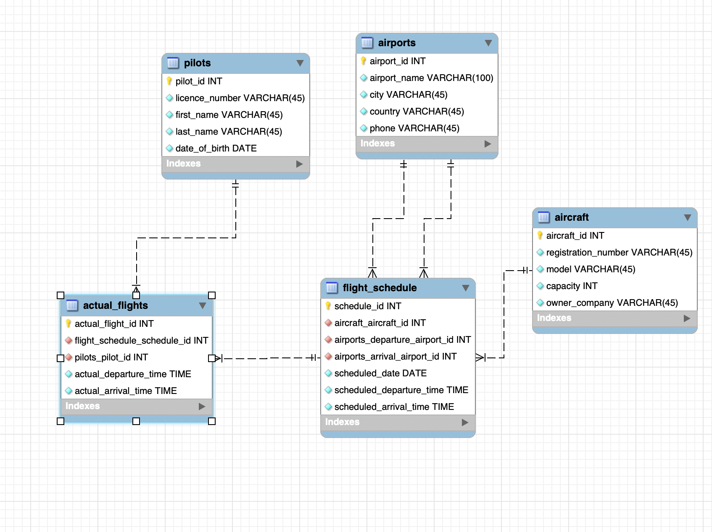
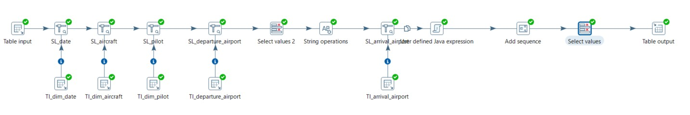
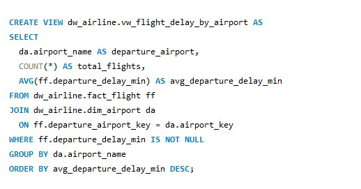

# Case study: from flight schedules to delay reporting

## Business question

How can operational flight records be reorganised to compare punctuality across departure airports, airline companies, and dates? The course scenario describes an aviation authority holding transactional data. The project turns that operational structure into an analytical warehouse; it does not establish that these records originated from a real aviation authority.

## Original course implementation

The group used MySQL Workbench to model five source tables: `airports`, `aircraft`, `pilots`, `flight_schedule`, and `actual_flights`. The saved CSVs contain 250 rows per table. Aircraft and departure/arrival airport keys belong to the schedule; the actual flight references the schedule and assigned pilot.

The saved analytical model uses four dimensions and a central `fact_flight` table. Surrogate keys separate source identifiers from warehouse identifiers. The two airport references allow departure and arrival locations to share one dimension. The date dimension supports calendar analysis; the fact carries scheduled/actual times, durations, delay measures, and a delay flag.

The submitted report and screenshots document Pentaho transformations for dimensions and the flight fact: source extraction, stream lookups, generated keys, field selection, and calculated values before loading MySQL. They also document SQL views for daily operations, airport delays, and arrival/departure delays by airline.

Pentaho Report Designer produced an airport-level report ordered by average departure delay. Its [PDF export](../reports/original/airport-delay-report.pdf) is retained as historical evidence. The `.ktr` and `.prpt` source files were not found, so the exact original desktop execution cannot be reproduced from this repository alone.

## Portfolio reproduction and quality review

A new Python/SQLite implementation rebuilds a compatible four-dimension warehouse from a minimized copy of the CSVs. It includes the execution identifier in the fact table to enforce and test one row per actual execution, exports three aggregate views, and requires no external Python packages.

The quality review found an important rollover issue: the original PDF shows −1,406 minutes of arrival delay for a Raleigh-Durham record. Subtracting clock times alone can turn a small delay across midnight into a value close to −24 hours. The reproduction uses the nearest signed clock difference and explicitly assumes a delay within twelve hours either way. That example becomes +34 minutes under this assumption. The corrected output is separate from the original report.

The same method yields 14.28 minutes mean departure delay and 18.856 minutes mean arrival delay across 250 executions. These are educational sample results rather than operational findings about the airlines shown. Counts are included in each aggregate because many airports have only one or two observed flights.

## What a production extension would need

The next step would be complete timezone-aware departure and arrival timestamps, a documented and licensed data source, clearer business definitions of on-time performance, and minimum sample sizes for comparisons. Incremental loads, slowly changing dimensions, lineage, monitoring, and a deployable scheduler would be further extensions; they are not claimed as implemented here.
